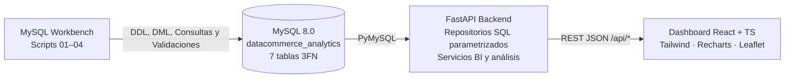

# DataCommerce Analytics

**Business Intelligence & Commercial Performance**

Sistema integral de inteligencia comercial para **DataCommerce Analytics S.A.S.** (actividad académica de Ingeniería de Sistemas basada en `tercer corte.pdf`). Incluye base de datos relacional normalizada en **MySQL 8.0**, conjunto determinista de datos sintéticos colombianos (`658` registros), API REST en **Python + FastAPI**, dashboard ejecutivo interactivo en **React + TypeScript + Vite + Tailwind CSS + Recharts + Leaflet**, suite de `75` pruebas automatizadas (`pytest`), evidencias de ejecución reales y documentación técnica y analítica completa.

---

## Arquitectura del sistema



---

## Stack tecnológico

- **Base de datos:** MySQL 8.0 (`InnoDB`, `utf8mb4`), 7 tablas en 3FN con claves primarias `AUTO_INCREMENT`, `FOREIGN KEY` con `ON DELETE RESTRICT`, `UNIQUE`, `CHECK` e índices analíticos.
- **Backend:** Python 3.14, FastAPI, Uvicorn, PyMySQL (consultas 100 % parametrizadas), `python-dotenv`, separación por capas (`config`, `database`, `filters`, `repositories`, `services`, `routers`).
- **Frontend:** React 18, TypeScript, Vite, Tailwind CSS, Recharts, Leaflet + React-Leaflet (OpenStreetMap), Lucide React, formato monetario colombiano (`$ 1.250.000 COP`).
- **Calidad y pruebas:** Pytest + FastAPI TestClient contra MySQL real (`75` pruebas aprobadas).

---

## Inicio rápido (Windows sin Docker)

> Consulte el detalle completo y solución de errores en [documentacion/manual_ejecucion.md](documentacion/manual_ejecucion.md).

### 1. Configurar variables de entorno y MySQL 8.0
```powershell
Copy-Item .env.example .env
# Edite .env y defina DB_PASSWORD con su clave de MySQL
```
Ejecute los scripts en orden en **MySQL Workbench** o consola MySQL:
1. [database/01_esquema.sql](database/01_esquema.sql)
2. [database/02_datos.sql](database/02_datos.sql)
3. [database/03_consultas_analiticas.sql](database/03_consultas_analiticas.sql)
4. [database/04_validaciones.sql](database/04_validaciones.sql)

### 2. Iniciar el backend (FastAPI)
```powershell
cd backend
python -m venv .venv
.\.venv\Scripts\Activate.ps1
pip install -r requirements.txt
uvicorn app.main:app --reload --port 8000
```

### 3. Iniciar el frontend (React + Vite)
En otra terminal:
```powershell
cd frontend
npm install
npm run dev
```
Abra **`http://localhost:5173`** en su navegador (y **`http://localhost:8000/docs`** para Swagger UI).

---

## Ejecución de pruebas automatizadas

```powershell
.\backend\.venv\Scripts\python.exe -m pytest tests -v
```

---

## Estructura del proyecto

```text
bigdata-datacommerce-analytics/
├── backend/
│   ├── app/
│   │   ├── repositories/     # SQL parametrizado contra MySQL 8.0
│   │   ├── routers/          # Endpoints REST /api/*
│   │   ├── services/         # Lógica de negocio, KPIs, RFM, lectura script 03
│   │   ├── config.py         # Configuración desde .env
│   │   ├── database.py       # Conexión PyMySQL
│   │   ├── filters.py        # Filtros globales validados
│   │   └── main.py           # Aplicación FastAPI
│   ├── Dockerfile
│   └── requirements.txt
├── database/
│   ├── generador/generar_datos.py  # Generador determinista (semilla 2026)
│   ├── 01_esquema.sql              # DDL base de datos y 7 tablas
│   ├── 02_datos.sql                # 658 registros sintéticos colombianos
│   ├── 03_consultas_analiticas.sql # 9 consultas obligatorias + Consulta 10 RFM
│   └── 04_validaciones.sql         # 15 validaciones de integridad y consistencia
├── documentacion/
│   ├── analisis_comercial.md       # 4 preguntas, RFM, 3 estrategias y limitaciones
│   ├── conclusiones.md             # Conclusiones técnicas
│   ├── consultas_explicadas.md     # SQL, explicación y resultados reales
│   ├── diccionario_datos.md        # Campos, tipos, restricciones y fórmulas
│   ├── manual_ejecucion.md         # Guía de despliegue y solución de errores
│   ├── matriz_requisitos.md        # Trazabilidad contra tercer corte.pdf
│   ├── modelo_relacional.md        # Diseño y diagrama ER en Mermaid
│   └── normalizacion.md            # 1FN, 2FN, 3FN, dependencias y anomalías
├── evidencias/                     # Capturas reales y salidas de ejecución
├── frontend/
│   ├── src/
│   │   ├── components/             # FilterBar, KpiCard, SortableTable, UI
│   │   ├── context/                # Estado de filtros globales
│   │   ├── pages/                  # 7 vistas del dashboard
│   │   ├── services/               # Cliente REST
│   │   ├── types/                  # Tipos TypeScript
│   │   └── utils/                  # Formato COP y fechas
│   ├── Dockerfile
│   └── package.json
├── tests/                          # 75 pruebas contra MySQL real y FastAPI
├── .env.example
├── .gitignore
├── docker-compose.yml
└── README.md
```

---

## Endpoints principales de la API

| Método y ruta | Descripción |
|---|---|
| `GET /api/health` | Estado del servicio y conectividad con MySQL |
| `GET /api/catalogos/filtros` | Listas de ciudades, vendedores, categorías y rango de fechas |
| `GET /api/dashboard/kpis` | 8 KPIs principales y variación frente al periodo comparable |
| `GET /api/dashboard/ventas-mensuales` | Serie mensual agrupada por año y mes |
| `GET /api/ciudades/rendimiento` | Métricas geográficas, participación y coordenadas |
| `GET /api/vendedores/ranking` | Desempeño de vendedores, ticket promedio y utilidad |
| `GET /api/categorias/rentabilidad` | Ingresos netos, costos, utilidad, margen y rankings |
| `GET /api/productos/ranking` | Desempeño de productos e indicador sobre promedio |
| `GET /api/clientes/recurrentes` | Clientes con más de una factura |
| `GET /api/clientes/premium` | Segmentación RFM (`Premium`, `Potencial premium`, `Regular`) |
| `GET /api/analisis/ejecutivo` | Hallazgos observados, concentración HHI, riesgos e interpretaciones |
| `GET /api/consultas` / `GET /api/consultas/{n}` | Ejecución en vivo del SQL literal de `03_consultas_analiticas.sql` |

---

## Resultados destacados (verificados en MySQL 8.0)

- **Ingresos totales:** `$ 351.210.800 COP` · **Utilidad:** `$ 102.499.200 COP` (`29,18 %` de margen) · **Transacciones:** `180`.
- **Ciudad líder:** Bogotá (`$ 128.655.400 COP`, `36,63 %`). **Mayor crecimiento:** Pereira (`+736,49 %` comparable, ticket promedio `$ 2.750.192 COP`).
- **Categoría más rentable:** Hogar y Muebles (`$ 25.743.200 COP` de utilidad, `36,66 %` de margen) frente a Tecnología líder en facturación (`$ 133.838.500 COP`, `17,10 %` de margen).
- **Segmentación RFM (corte `2026-11-18`):** `7` clientes **Premium** (`52,54 %` de los ingresos), `11` **Potencial premium** (`28,83 %`) y `10` **Regular** (`18,63 %`).
