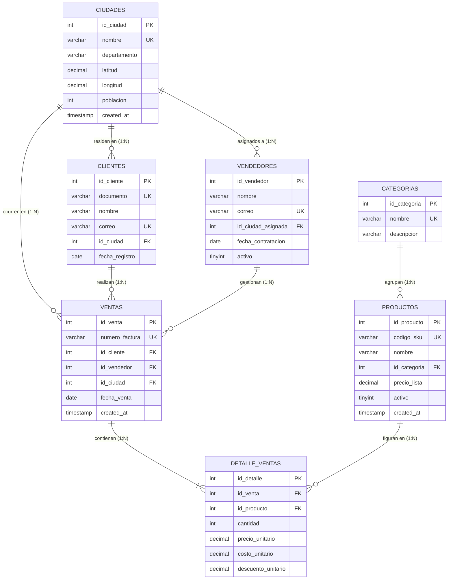

# Modelo Relacional — DataCommerce Analytics

**Empresa:** DataCommerce Analytics S.A.S.  
**Base de datos:** `datacommerce_analytics`  
**Motor:** MySQL 8.0 (`InnoDB`, conjunto de caracteres `utf8mb4`, intercalación `utf8mb4_unicode_ci`)  
**Script fuente:** [01_esquema.sql](../database/01_esquema.sql)

---

## 1. Introducción al modelo

El sistema de inteligencia comercial de **DataCommerce Analytics S.A.S.** requiere almacenar operaciones de venta en múltiples ciudades de Colombia manteniendo integridad referencial, trazabilidad histórica de precios y costos, y soporte eficiente para consultas analíticas (agregaciones por ciudad, vendedor, categoría, producto, mes y segmentación de clientes).

El modelo relacional se diseñó en **Tercera Forma Normal (3FN)** con **siete tablas** relacionadas mediante claves primarias y foráneas explícitas:

1. `ciudades`
2. `clientes`
3. `vendedores`
4. `categorias`
5. `productos`
6. `ventas`
7. `detalle_ventas`

---

## 2. Diagrama Entidad–Relación (Mermaid)

> **Nota sobre visualización y exportación:** Este diagrama en sintaxis Mermaid puede renderizarse directamente en GitHub, VS Code / Antigravity (con vista previa Markdown + Mermaid) o en [Mermaid Live Editor](https://mermaid.live/) para exportarlo a PNG o SVG. Adicionalmente, puede generarse la ingeniería inversa directamente en **MySQL Workbench** (*Database → Reverse Engineer*).

---

## 3. Descripción de las tablas

| # | Tabla | Propósito | Registros de prueba |
|---|---|---|---|
| 1 | `ciudades` | Catálogo de plazas operativas en Colombia con coordenadas geográficas (`latitud`, `longitud`) para georreferenciación en el mapa del dashboard y población aproximada de contexto. | 8 |
| 2 | `clientes` | Registro maestro de compradores (con documento ficticio único, correo electrónico único, ciudad de residencia y fecha de registro). | 30 |
| 3 | `vendedores` | Fuerza comercial de la empresa, con correo corporativo único, ciudad principal asignada, fecha de contratación y estado (`activo`). | 10 |
| 4 | `categorias` | Agrupación comercial del portafolio de productos (cinco líneas de negocio). | 5 |
| 5 | `productos` | Catálogo de artículos con código SKU único, categoría, `precio_lista` vigente en COP y estado (`activo` / descontinuado). | 30 |
| 6 | `ventas` | Encabezado de cada factura o transacción: número de factura único, cliente, vendedor, **ciudad donde ocurrió la venta** y fecha de la transacción. | 180 |
| 7 | `detalle_ventas` | Líneas de cada factura que resuelven la relación **N:M** entre `ventas` y `productos`, preservando `cantidad`, `precio_unitario`, `costo_unitario` y `descuento_unitario` históricos al momento de la venta. | 395 |

---

## 4. Claves primarias, claves foráneas y cardinalidades

### 4.1 Claves primarias (PK)

Todas las tablas emplean claves primarias subrogadas enteras (`INT NOT NULL AUTO_INCREMENT`), lo que garantiza:
- Unicidad absoluta e inmutabilidad del identificador aunque cambien atributos de negocio (como el nombre de un producto o el correo de un cliente).
- Índices agrupados (*clustered indexes*) compactos en `InnoDB`, favoreciendo la velocidad de los `JOIN`.

Además, se mantienen **claves candidatas protegidas con restricciones `UNIQUE`**:
- `ciudades.nombre` (`uq_ciudad_nombre`)
- `clientes.documento` (`uq_cliente_documento`) y `clientes.correo` (`uq_cliente_correo`)
- `vendedores.correo` (`uq_vendedor_correo`)
- `categorias.nombre` (`uq_categoria_nombre`)
- `productos.codigo_sku` (`uq_producto_sku`)
- `ventas.numero_factura` (`uq_venta_factura`)
- Par `(id_venta, id_producto)` en `detalle_ventas` (`uq_detalle_venta_producto`) para impedir que un mismo producto aparezca duplicado en líneas separadas dentro de la misma factura.

### 4.2 Claves foráneas y relaciones

| Relación | Tabla padre (1) | Tabla hija (N) | Columna FK | Cardinalidad | Política referencial |
|---|---|---|---|---|---|
| Residencia del cliente | `ciudades` | `clientes` | `id_ciudad` | `1 : N` | `ON UPDATE CASCADE`, `ON DELETE RESTRICT` |
| Plaza asignada al vendedor | `ciudades` | `vendedores` | `id_ciudad_asignada` | `1 : N` | `ON UPDATE CASCADE`, `ON DELETE RESTRICT` |
| Clasificación del producto | `categorias` | `productos` | `id_categoria` | `1 : N` | `ON UPDATE CASCADE`, `ON DELETE RESTRICT` |
| Comprador de la factura | `clientes` | `ventas` | `id_cliente` | `1 : N` | `ON UPDATE CASCADE`, `ON DELETE RESTRICT` |
| Vendedor que cierra la venta | `vendedores` | `ventas` | `id_vendedor` | `1 : N` | `ON UPDATE CASCADE`, `ON DELETE RESTRICT` |
| Ciudad donde ocurre la venta | `ciudades` | `ventas` | `id_ciudad` | `1 : N` | `ON UPDATE CASCADE`, `ON DELETE RESTRICT` |
| Líneas de una factura | `ventas` | `detalle_ventas` | `id_venta` | `1 : N` | `ON UPDATE CASCADE`, `ON DELETE RESTRICT` |
| Producto vendido en línea | `productos` | `detalle_ventas` | `id_producto` | `1 : N` | `ON UPDATE CASCADE`, `ON DELETE RESTRICT` |

### 4.3 Resolución de la relación N:M entre `ventas` y `productos`

Una factura puede incluir varios productos y un mismo producto puede aparecer en múltiples facturas. Esta relación **N:M** no puede representarse directamente en un modelo relacional sin violar la Primera Forma Normal (grupos repetitivos) ni sin duplicar encabezados de factura.

Se resuelve mediante la entidad asociativa `detalle_ventas`, que descompone la relación `N:M` en dos relaciones `1:N`:
- `ventas (1) ──< (N) detalle_ventas`
- `productos (1) ──< (N) detalle_ventas`

Cada fila de `detalle_ventas` aporta además los atributos propios de la asociación (`cantidad`, `precio_unitario`, `costo_unitario`, `descuento_unitario`).

---

## 5. Decisiones de diseño críticas

### 5.1 Independencia entre ciudad de la venta y ciudad del cliente
La columna `ventas.id_ciudad` registra el lugar donde ocurrió la transacción de forma independiente de `clientes.id_ciudad` (ciudad de residencia) y de `vendedores.id_ciudad_asignada`. En el conjunto de datos verificado, **33 de las 180 ventas (18,3 %)** ocurrieron en una ciudad distinta a la de residencia del cliente, y un vendedor de Medellín (`Juan Pablo Rodríguez`) cerró **4 ventas** en otras plazas. Si se hubiera deducido la geografía desde `clientes`, el reporte de ingresos por ciudad habría distorsionado la operación comercial real.

### 5.2 Preservación de precios, costos y descuentos históricos
El catálogo (`productos.precio_lista`) refleja el valor comercial **vigente** (2026), mientras que `detalle_ventas` almacena `precio_unitario`, `costo_unitario` y `descuento_unitario` al instante de la transacción. En los datos de 2025 la lista de precios era 6 % inferior a la de 2026. Gracias a esta separación, actualizar `productos.precio_lista` en el futuro **no altera retrospectivamente** los ingresos ni las utilidades históricas reportadas en años anteriores.

### 5.3 Protección contra eliminaciones accidentales (`ON DELETE RESTRICT`)
Todas las 8 claves foráneas utilizan `ON DELETE RESTRICT` en lugar de `ON DELETE CASCADE`. Esto impide borrar una ciudad, un cliente, un vendedor, un producto o un encabezado de factura si existen registros históricos asociados. La prueba automática `test_restriccion_rechaza_operacion_invalida` y el procedimiento `sp_probar_restricciones()` verifican en MySQL 8.0 que estas eliminaciones son rechazadas.

### 5.4 Precisión monetaria en pesos colombianos (COP)
Los importes monetarios se definen como `DECIMAL(12, 2) NOT NULL`, evitando errores de redondeo binario propios de `FLOAT`/`DOUBLE` y permitiendo cifras hasta `$ 9.999.999.999,99 COP`, rango suficiente para transacciones comerciales unitarias y agregadas. Todos los campos numéricos que intervienen en cálculos (`cantidad`, `precio_unitario`, `costo_unitario`, `descuento_unitario`) son `NOT NULL` y tienen restricciones `CHECK` para evitar valores inválidos (`cantidad > 0`, `precio_unitario > 0`, `costo_unitario >= 0`, `descuento_unitario >= 0` y `descuento_unitario < precio_unitario`).

---

## 6. Estrategia de indexación

Además de los índices automáticos creados por MySQL sobre claves primarias y restricciones `UNIQUE`, el esquema declara explícitamente índices secundarios sobre las columnas empleadas en filtros, uniones (`JOIN`) y agrupaciones (`GROUP BY`):

| Índice | Tabla | Columna | Justificación analítica |
|---|---|---|---|
| `idx_clientes_ciudad` | `clientes` | `id_ciudad` | Cruce de clientes con su ciudad de residencia (Consultas 7 y 10). |
| `idx_clientes_fecha_registro` | `clientes` | `fecha_registro` | Segmentación por antigüedad de registro. |
| `idx_vendedores_ciudad` | `vendedores` | `id_ciudad_asignada` | Consulta 4 (vendedor con su ciudad asignada). |
| `idx_productos_categoria` | `productos` | `id_categoria` | Agrupación de rentabilidad y participación por categoría (Consultas 3 y 9). |
| `idx_ventas_cliente` | `ventas` | `id_cliente` | Agregación de frecuencia y gasto por cliente (Consultas 7 y 10). |
| `idx_ventas_vendedor` | `ventas` | `id_vendedor` | Ranking y promedio por vendedor (Consultas 2 y 4). |
| `idx_ventas_ciudad` | `ventas` | `id_ciudad` | Rendimiento geográfico y filtro por ciudad (Consultas 1 y 6). |
| `idx_ventas_fecha` | `ventas` | `fecha_venta` | Consultas mensuales (Consulta 8), ventanas RFM (Consulta 10) y filtros por rango de fechas del dashboard. |
| `idx_detalle_venta` | `detalle_ventas` | `id_venta` | Reconstrucción de totales por factura. |
| `idx_detalle_producto` | `detalle_ventas` | `id_producto` | Cálculo de ingresos y unidades por producto y categoría (Consultas 3, 5 y 9). |
